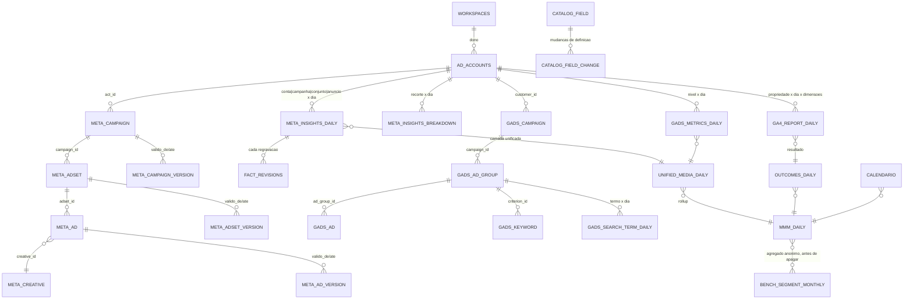

# MMM v2: armazém de dados de mídia por plataforma

**Direção aprovada em 16/11/2026** (seção 12):
- o recente fica no Postgres;
- o histórico pesado e as respostas brutas vão para Parquet no Storage, numa pasta por workspace, plataforma e conta;
- o cancelamento apaga só a pasta da parcela cancelada.

**Benchmark:** fica só o desenho. Nada de agregado entre anunciantes é calculado nem guardado até sair o parecer jurídico.

Ainda não há migration nem código do armazém. O Redis (Upstash) já está no código para limite de chamadas e cache curto (seção 10). As decisões que faltam estão na seção 12.

Marcações:
- **[M]** medido em produção, só com leitura;
- **[E]** estimativa;
- **[F]** vem de fonte externa (lista no fim). Várias das fontes de retenção são de terceiros e precisam ser conferidas na documentação oficial antes de virarem regra.

## 0. Onde estamos (16/11/2026)

Medição de 16/11, antes da decisão de ligar a carga (seção 12). Para ver o estado atual da fila: `npm run mmm:backfill -- --status`.

- **Schema `mmm` v1:** aplicado (migration `20261117090000_mmm_schema`) e **vazio** [M]: `raw_insights` 0 linhas, `media_daily` 0, `daily` 0.
- **Fila `mmm.backfill_jobs`:** existe e está **desligada** [M].
  - `mmm.backfill_control.ativo = false`, atualizado pela última vez em 13/11.
  - Nenhum trabalho na fila: o `--enqueue` não foi rodado.
- **O que o app guarda hoje** (tabelas `public.insights_*`): de 31/07/2026 em diante.
  - Fatos são sobrescritos por upsert e "podados".
  - Entidades (campanha, anúncio) não têm histórico.
- **Urgência:** as APIs só devolvem uma janela, que anda todo mês.

| Plataforma | O que a API ainda devolve [F] | Consequência |
|---|---|---|
| Meta | Totais: 37 meses. Contagens únicas (alcance, frequência) com recorte e recortes por hora: 13 meses. Frequência com recorte: 6 meses. Desde 12/01/2026, as janelas 7d_view e 28d_view saíram. | Recortes demográficos e por hora são os primeiros a sumir: prioridade 1. |
| Google Ads | Dados diários, semanais e por hora: 37 meses (desde 01/06/2026). `click_view`: 90 dias. | Começar já; antes da janela andar, o histórico de 2023 some. |
| GA4 | Métricas de mídia truncadas em 36 meses. Dados por evento: 2 ou 14 meses, conforme a propriedade. | Guardar os relatórios diários agregados. |
| TikTok | Sem limite oficial publicado; os conectores de mercado trazem desde 2016 ou 24 meses. | Começar com 24 meses e medir. |
| LinkedIn | Os dados de desempenho ficam 10 anos; a granularidade diária, menos (fonte secundária fala em 6 meses); os demográficos (`MEMBER_*`), 2 anos por mês. | Puxar o diário com frequência; ele envelhece rápido. |

**Decisão já tomada:** o cache é o nosso histórico. Guardamos por anos e começamos o quanto antes.

## 1. Princípios

1. **Nomes nativos.** Cada plataforma tem as suas tabelas, com os nomes de campo da API (`inline_link_clicks`, `metrics.cost_micros`, `sessionDefaultChannelGroup`). A tradução para "investimento, cliques, conversões" fica só na camada unificada (seção 5).
2. **Nada é sobrescrito sem deixar rastro.**
   - Entidades: versão com "válido de/até".
   - Fatos: a linha atual mais um registro de cada revisão.
   - Bruto: guardado comprimido.
3. **Tudo tem dono.** Toda linha leva `workspace_id`, `ad_account_id` (ou `connection_id`) e `platform_id`. É isso que permite apagar só a parcela cancelada (seção 7).
4. **Quente no Postgres, frio em arquivo** (seção 8): o painel lê o recente no Postgres; o histórico pesado mora em Parquet.
5. **Nada de nomear ou identificar** clientes fora do workspace dono. A única exceção é o benchmark anônimo (seção 6).

## 2. Diagrama

Os schemas no Postgres:

| Schema | O que guarda | Quem lê |
|---|---|---|
| `wh_core` | Catálogo de campos, registro de cargas (`load_runs`), revisões de fatos, manifesto dos arquivos Parquet | service_role |
| `wh_meta`, `wh_gads`, `wh_ga4`, `wh_tiktok`, `wh_linkedin` (e um por plataforma nova) | Entidades com versões, fatos diários e recortes, com nomes nativos | service_role; membros por RLS, se o painel precisar |
| `mmm` (v1, reaproveitado) | Camada unificada, resultados, calendário, eventos, `daily` | membros do workspace (RLS) |
| `bench` | Agregados anônimos por segmento | service_role (o painel lê por função, nunca a tabela) |

## 3. Tabelas por plataforma

O mesmo molde vale para todas as plataformas. Abaixo, a Meta completa e as diferenças das outras.

### 3.1 Entidades com histórico (SCD tipo 2)

Duas tabelas por entidade:
- **identidade:** `wh_meta.campaign`, com `campaign_id` nativo, `account_id`, `workspace_id`, `ad_account_id`, `created_time`, `first_seen_at` e `last_seen_at`;
- **versões:** `wh_meta.campaign_version`, com `campaign_id`, `valid_from`, `valid_to` (nulo = atual), `content_hash` e os campos nativos.

Os campos nativos das versões, por entidade:
- **campanha:** `name`, `status`, `effective_status`, `objective`, `buying_type`, `bid_strategy`, `daily_budget`, `lifetime_budget`, `spend_cap`, `special_ad_categories`, `start_time`, `stop_time`;
- **conjunto (`adset_version`):** `optimization_goal`, `billing_event`, `bid_amount`, `bid_strategy`, `daily_budget`, `lifetime_budget`, `attribution_spec`, `promoted_object`, `targeting` (jsonb), `destination_type`;
- **anúncio (`ad_version`):** `name`, `status`, `effective_status`, `creative_id`, `tracking_specs`;
- **criativo (`creative`):** `object_story_spec`, `asset_feed_spec`, `title`, `body`, `call_to_action_type`, `thumbnail_url`, `image_hash`, `video_id`. Um criativo da Meta não muda depois de criado: guarda só a identidade.

Toda versão leva `raw jsonb`, com a resposta inteira da API, para não perder campo que ainda não tem coluna.

Regra de gravação:
1. Calcula o hash dos campos.
2. Se mudou, fecha a versão atual (`valid_to = now()`) e abre outra.
3. Nunca dá `update` nos campos de uma versão.

Isso dá o histórico de orçamento, lance, objetivo e nome que o MMM pede (seção 2 da v1).

Nas outras plataformas:
- **Google Ads:**
  - entidades: `customer` → `campaign` (+ `campaign_budget`, `bidding_strategy`) → `ad_group` → `ad_group_ad` (+ `asset` e `ad_group_ad_asset_view`) → `ad_group_criterion`;
  - `ad_group_criterion` traz as palavras-chave, com `keyword.text`, `keyword.match_type` e `cpc_bid_micros`;
  - entra também `conversion_action`: o que conta como conversão muda, e o MMM precisa saber quando.
- **TikTok:** `advertiser` → `campaign` → `adgroup` → `ad`.
- **LinkedIn:** `account` → `campaign_group` → `campaign` → `creative`.
- **GA4:** sem hierarquia de mídia. Guarda `property`, `data_stream`, os eventos-chave (`key_event`) com versão, e as dimensões e métricas personalizadas.

### 3.2 Fatos diários por nível

`wh_meta.insights_daily`, particionada por mês em `date_start`. A chave é `(level, object_id, date_start, attribution_key)`. As colunas:
- `level` (`account|campaign|adset|ad`), `object_id`, `account_id`, `workspace_id`, `ad_account_id`, `date_start`;
- `attribution_setting`, como a API devolve em cada linha, e `action_attribution_windows text[]`, o pedido;
- `attribution_key`: hash dos dois campos acima, para comparar janelas sem misturar;
- métricas mais usadas em colunas com tipo e nome nativo: `spend`, `impressions`, `reach`, `frequency`, `clicks`, `inline_link_clicks`, `outbound_clicks`, `cpm`, `ctr`, `video_p25_watched_actions`…;
- arrays da Meta em jsonb, com a chave por janela (`7d_click`, `1d_view`): `actions`, `action_values`, `conversions`, `conversion_values`, `cost_per_action_type`;
- `fields jsonb`: **todos** os campos que a API devolveu, com nome nativo. É a garantia do "todas as métricas"; uma métrica vira coluna só quando o painel ou o MMM precisa;
- `fetched_at`, `load_run_id`, `revision` (contador).

Google Ads (`wh_gads.metrics_daily`) segue o mesmo molde:
- os campos `metrics.*` e `segments.date`, com o nome GAQL (`metrics.cost_micros`, `metrics.conversions_value`…), por `level` (customer, campaign, ad_group, ad_group_ad);
- `segments.conversion_action` em tabela própria, porque multiplica as linhas;
- `wh_gads.search_term_daily`, a partir de `search_term_view`;
- `wh_gads.keyword_daily`, a partir de `keyword_view`.

No GA4 (`wh_ga4.report_daily`) não existe "todas as métricas" num relatório só: a API recusa algumas combinações de dimensão e métrica. A tabela guarda um conjunto fixo de relatórios, versionado no catálogo:
- canal;
- origem / mídia / campanha;
- página de entrada;
- eventos-chave;
- e-commerce.

Cada relatório tem uma `report_key`.

### 3.3 Fatos por recorte

`wh_meta.insights_breakdown_daily` tem a mesma chave dos fatos mais `breakdown_set` (ex.: `age,gender`) e as colunas do recorte com nome nativo: `age`, `gender`, `country`, `region`, `publisher_platform`, `platform_position`, `impression_device`, `device_platform`, `hourly_stats_aggregated_by_advertiser_time_zone`.

Prioridade, pelo que some antes [F]:

| Ordem | Recorte | Nível | Por quê |
|---|---|---|---|
| 1 | idade × gênero, com `reach` e `frequency` | conjunto | Contagem única com recorte: 13 meses (frequência, 6) |
| 2 | hora (fuso do anunciante) | campanha | Recorte por hora: 13 meses |
| 3 | região (UF) e país | campanha | Contagem única com recorte: 13 meses |
| 4 | posicionamento (`publisher_platform`, `platform_position`) | conjunto | Usado no MMM por canal |
| 5 | dispositivo | campanha | Menor valor; o mais barato de buscar |

Cuidado: `reach` e `frequency` não somam entre linhas de recorte (são pessoas únicas). Guarde exatamente o que a API devolve em cada grão e **nunca** some isso na camada unificada.

Google Ads: `segments.device`, `segments.hour`, `segments.day_of_week`, `geographic_view` e `age_range_view` / `gender_view`, no mesmo molde.

## 4. Catálogo de métricas e dimensões

`wh_core.catalog_field`:
- `platform_id`, `api_version`, `field` (nome nativo), `kind` (`metric|dimension|attribute`);
- `data_type`, `unit` (moeda em micros, %, contagem), `description_pt`, `description_api`;
- `first_seen_at`, a primeira carga em que apareceu, e `available_since`, quando a documentação diz;
- `deprecated_at`, `notes`.

`wh_core.catalog_field_change` registra cada mudança de definição, com data e fonte: `platform_id`, `field`, `changed_at`, `what` e `source_url`. Exemplos:
- Meta 12/01/2026: `7d_view`/`28d_view` fora;
- Google 01/06/2026: 37 meses;
- troca da definição de clique na Meta (relatada por terceiros, não confirmada).

O MMM lê essa tabela para marcar quebras de série.

Como encher o catálogo:
- carga inicial a partir da documentação de cada API, que tem os campos com descrição;
- depois, a cada carga, um campo novo que aparecer em `fields jsonb` entra sozinho com `first_seen_at`.

## 5. Recarga dos últimos dias sem perder histórico

As plataformas revisam números recentes:
- **Meta:** conversões chegam até o fim da janela (hoje, 28 dias para clique);
- **Google:** pelo prazo de conversão de cada ação (padrão de 30 dias, até 90).

Proposta:

1. **Cadência:**
   - todo dia, os últimos 3 dias (já é o que alimenta o "em maturação");
   - toda semana, os últimos 28 dias (Meta) ou 30 dias (Google), fora do horário de pico;
   - todo mês, um "fechamento" do mês anterior.
2. **Gravação:**
   - a linha atual é atualizada por upsert na chave;
   - antes, se algum valor mudou, a versão anterior vai para `wh_core.fact_revisions` (`table_name, key jsonb, revision, values jsonb, replaced_at, load_run_id`);
   - nada é apagado. Um "sumiço" (a API não devolve mais a linha) vira `deleted_at`, não `delete`. Diferente do `pruneStale` de hoje.
3. **Maturação:**
   - `is_mature = date_start < hoje - janela da plataforma`;
   - o painel continua mostrando os 3 últimos dias como "em maturação";
   - o MMM só usa dias maduros, ou corrige com a curva de maturação.
   - Bônus: `fact_revisions` mede essa curva por conta e plataforma, o que é bom para a análise preditiva.
4. **Bruto:** cada resposta da API vai comprimida (JSON gz) para o Storage, com o `request_hash`. Dá para reprocessar tudo se o mapeamento mudar.

## 6. Camada unificada (até o `mmm.daily`)

1. **`mmm.media_daily`** (já existe na v1). Ganha:
   - `level` e `object_id`, para MMM por campanha ou por canal;
   - `attribution_key`, para comparar janelas;
   - `is_mature`;
   - `source_table`, para saber de que tabela nativa veio.

   Os nomes passam a ser os padronizados: `spend`, `impressions`, `clicks`, `conversions`, `conversion_value`, `spend_brl`.

2. **`mmm.outcomes_daily`** (já existe): GA4, CRM e planilha.
3. **`mmm.calendario`** e **`mmm.eventos`** (já existem).
4. **`mmm.daily`** (já existe), recalculado por `mmm.rollup_daily`. Ganha `is_mature` e o canal padronizado (Meta, Google Search, Google PMax, YouTube, TikTok, LinkedIn…).

O mapeamento nativo → unificado vive numa tabela de regras, `wh_core.unified_map` (plataforma, campo nativo, campo unificado, fórmula). Assim uma mudança de definição (seção 4) vira uma linha nova com data, não código novo.

## 7. Cancelamento granular

Decisão tomada: apagar só a parcela cancelada; o resto continua.

| O cliente cancela ou exclui | Postgres | Arquivos (Parquet e bruto) | Benchmark |
|---|---|---|---|
| uma **conta de anúncio** | `delete … where ad_account_id = $1` em todas as tabelas `wh_*` e `mmm.*` (FK com cascade a partir de `ad_accounts`) | apaga o prefixo `…/{ad_account_id}/` | antes, fecha os agregados dos meses dessa conta (seção 9) |
| uma **conexão de plataforma** | o mesmo, para cada conta daquela conexão (`connection_id`), ou `workspace_id` + `platform_id` | apaga `…/{platform_id}/` daquele workspace | idem |
| um **workspace** | cascade a partir de `workspaces` (inclui `mmm.eventos` e `mmm.outcomes_daily`) | apaga `{workspace_id}/` | idem |

Por isso o caminho dos arquivos é `wh/{workspace_id}/{platform_id}/{ad_account_id}/{tabela}/{ano}/{mes}.parquet`: cada nível de cancelamento é um prefixo.

O fluxo de exclusão de hoje (`account-deletion.ts`, `SHELL_PURGE_ORDER`) ganha dois passos:
1. apagar as tabelas `wh_*`;
2. apagar os prefixos no Storage.

A captura do benchmark antes de apagar só entra depois do parecer jurídico (seção 9).

Um teste deve conferir que nada do workspace sobrou.

## 8. Volume, custo e onde guardar

### 8.1 Volume

A base é medida em produção [M], para uma conta média de hoje:
- 5 campanhas × dia;
- 16 anúncios × dia;
- 50 linhas de recorte × dia;
- 27 termos de busca × dia no Google.

Com o armazém completo [E], por conta e dia:

| Item | Linhas | Tamanho no Postgres, com índices |
|---|---|---|
| Fatos por nível (conta + campanha + conjunto + anúncio), com `fields jsonb` | ~30 | ~2 KB/linha → 60 KB |
| Recortes priorizados (seção 3.3) | ~480 | ~0,5 KB/linha → 240 KB |
| Termos e palavras-chave (Google) | ~60 | ~0,5 KB → 30 KB |
| Revisões (recargas de 28 dias) | +30% | +100 KB |
| **Total** | **~740** | **~430 KB por conta e dia** |

Uma conta média dá ~160 MB por ano no Postgres. O bruto comprimido dá ~35 MB por ano. Uma conta grande (e-commerce com 100+ campanhas) pode dar 10× isso.

| 3 anos [E] | Linhas | Tudo no Postgres | Em Parquet (zstd, ~10× menor) | Bruto JSON gz |
|---|---|---|---|---|
| 50 contas | ~40 milhões | ~24 GB | ~2,5 GB | ~5 GB |
| 200 contas | ~160 milhões | ~96 GB | ~10 GB | ~21 GB |

### 8.2 Opções e custo (preços de lista em USD [F]; conferir na hora de decidir)

| Opção | Como fica | 50 contas, 3 anos | 200 contas, 3 anos | Riscos |
|---|---|---|---|---|
| **A. Tudo no Postgres do Supabase** | O mesmo banco do app | Disco: (24−8) × 0,125 ≈ US$ 2/mês. Compute: deve pedir Small/Medium (US$ 15 a 60/mês). | Disco ≈ US$ 11/mês. Compute: Large (US$ 110/mês) ou mais. | As recargas regravam muito (índices inchados, como medido na v1), e o backup e o vacuum crescem. Uma consulta pesada do MMM disputa CPU com o painel. |
| **B. Híbrido (recomendado)** | Postgres guarda as entidades, os fatos de conta e campanha completos, os 90 dias quentes de conjunto, anúncio e recorte, a camada `mmm` e o benchmark (~3 a 8 GB). O histórico de conjunto, anúncio e recortes e o bruto vão para Parquet no Supabase Storage (bucket privado). As consultas pesadas rodam com DuckDB num job. | Storage: ~7,5 GB × US$ 0,021 ≈ US$ 0,20/mês. Postgres: cabe no Pro. | Storage: ~31 GB ≈ US$ 0,70/mês. Postgres: Pro, talvez Small. | Duas formas de ler os dados. O DuckDB precisa rodar fora da função da Vercel se o volume crescer (GitHub Actions ou um worker). |
| **C. BigQuery (região São Paulo)** | Os fatos e recortes vão para tabelas particionadas; o Postgres fica só com o quente e a camada `mmm`. | Armazenamento: ~US$ 0,02 a 0,03/GB·mês (os 10 GiB iniciais são grátis) → ~US$ 0. Consultas: o primeiro 1 TiB/mês é grátis, depois US$ 6,25/TiB (preço dos EUA; São Paulo é mais caro). | ~US$ 1 a 3/mês de armazenamento; as consultas tendem a caber no grátis. | Fornecedor e credencial novos, e o LGPD (região SP) a configurar. Faz sentido se a análise em SQL crescer muito. |

Não pesquisei o preço do MotherDuck; fica como alternativa a avaliar para a opção B.

**Decisão: B** (aprovada em 16/11/2026). O disco do Postgres não é o problema; o problema é IO e compute dividindo o banco com o painel. Parquet por prefixo também resolve o cancelamento granular (seção 7) de graça. A troca para C fica aberta, porque o formato Parquet sobe direto para o BigQuery.

## 9. Benchmark por segmento (agregados anônimos): só desenho

> **Decisão (16/11/2026):** não calcular nem guardar agregados entre anunciantes até haver parecer jurídico. A tabela `bench`, o cálculo mensal e a captura antes da exclusão (seção 7) **não serão criados** até lá. Enquanto isso, cancelar ou excluir apaga tudo da parcela, sem exceção.

**Tabela `bench.segment_monthly`:**
- chave: `segmento` (o `business_type` do workspace), `mercado` (Brasil, ou a UF quando a célula permitir), `platform_id`, `objetivo`, `mes`;
- valores: `n_contas`, `n_workspaces`, e p25, p50 e p75 de CPM, CTR, CPC, custo por resultado e ROAS. Sem mínimo, máximo nem soma de investimento;
- **sem** nenhum id de conta, cliente, campanha ou criativo.

Regras para não identificar ninguém:
1. A célula só é gravada com **pelo menos 10 contas de pelo menos 5 workspaces diferentes**.
2. Nenhuma conta pode ter mais de 30% do investimento da célula (regra de dominância).
3. Só percentis, arredondados (CTR em 0,1 p.p., valores em R$ inteiros).
4. Uma célula que não passa é fundida na de cima (UF → Brasil; objetivo → todos) ou não é gravada.
5. O cálculo roda todo mês e também **antes** de qualquer exclusão (seção 7). Depois disso, é o único dado que fica do cliente.

O que precisa estar no contrato e nos Termos de Uso:
- licença para o VYZ criar e manter, inclusive depois do cancelamento, estatísticas agregadas e anonimizadas a partir dos dados das contas;
- compromisso de nunca identificar cliente, conta ou campanha, e de nunca vender ou repassar os agregados a terceiros;
- opt-in claro no contrato de tratamento de dados, com o motivo e as regras da seção acima;
- pela LGPD (art. 12), dado anonimizado de forma irreversível não é dado pessoal. Mesmo assim, a cláusula e o processo devem estar documentados.

O que os termos das plataformas permitem (pesquisa; **precisa de revisão jurídica antes de ligar**):
- **Meta, o maior risco.**
  - Os Platform Terms tratam como "Platform Data" também o dado anonimizado, agregado ou derivado: agregar não tira o dado das regras.
  - Os Advertising Standards limitam o uso do dado de anúncios ao "agregado e anônimo" e **para avaliar o desempenho das campanhas do próprio anunciante**.
  - Uma das fontes cita a proibição de misturar dados de vários anunciantes (*commingling*). Outra registra que uma cláusula restritiva foi removida; não consegui confirmar qual versão vale hoje.
  - Leitura conservadora: benchmark entre clientes com dados da Meta precisa de autorização da Meta ou de parecer jurídico.
- **Google Ads.**
  - A política da API pede **consentimento por escrito** do cliente antes de divulgar ou transferir dados específicos da conta dele, e permite relatórios agregados que misturam o Google com outras plataformas.
  - Não achei regra explícita sobre juntar dados anonimizados de vários anunciantes.
  - O Ads Data Hub (outro produto) proíbe divulgar resultados de benchmark.
  - O próprio Google passou a oferecer percentis de mercado na API (v25.2), que podem ser usados direto, sem montar o nosso.
- **GA4, TikTok e LinkedIn:** não pesquisei a fundo. O LinkedIn tem regras próprias de armazenamento (*data storage requirements*) que precisam ser lidas antes de guardar por anos.

Sugestão: criar a tabela e o cálculo, mas **não mostrar nada** a cliente nenhum até o parecer. Começar pelo Google, com consentimento no contrato, e pelos percentis oficiais do Google.

## 10. Redis: Upstash (já no código)

**Decisão:** Upstash, pela integração da Vercel, lido com `Redis.fromEnv()` (`KV_REST_API_URL` e `KV_REST_API_TOKEN`, ou `UPSTASH_REDIS_REST_URL` e `UPSTASH_REDIS_REST_TOKEN`).
- O código está em `src/server/cache/redis.ts`.
- Sem as variáveis, ou com o Redis fora do ar ou lento (mais de 400 ms), tudo funciona sem ele.
- A trava de sincronização continua no Postgres.

A tabela abaixo é o papel proposto antes da decisão. O que foi implementado:
- pausa compartilhada por limite da Meta e do Google (cabeçalhos de uso da Meta; operações do Google Ads por dia);
- cache de 10 minutos nas leituras da sincronização.

Papel proposto, sempre com TTL curto e sem histórico:

| Uso | Chave | TTL | Observação |
|---|---|---|---|
| Limite de chamadas por plataforma | `rl:meta:{app}`, `rl:gads:ops:{dia}` | 1 h / 1 dia | Guarda o último `x-fb-ads-insights-throttle` e o contador de operações do Google, que hoje vai ao banco (`mmm_google_ops_today`). Evita uma consulta ao banco por chamada. |
| Cache curto de respostas das APIs | `api:{plataforma}:{conta}:{hash da consulta}` | 5 a 15 min | Só respostas pequenas (listas de campanhas e contas), comprimidas. Com 30 MB, nada de relatório inteiro. |
| Trava de sincronização | `lock:sync:{ad_account_id}` | 10 min | **Já existe no Postgres:** o índice único de `sync_runs` barra a segunda sincronização da mesma conta. Sugestão: não duplicar; usar o Redis só se a trava do banco virar gargalo. |

O Upstash fala HTTP: não tem limite de conexões, funciona na Vercel e tem região em São Paulo. Por isso venceu o Redis Cloud (TCP, até 30 conexões).

## 11. O que fazer com a v1 do schema `mmm`

A v1 está aplicada e vazia, e a fila nunca rodou [M]. Recomendação: **reaproveitar e alterar**, não recriar.

- **Ficam como estão:**
  - `mmm.calendario`, `mmm.eventos`, `mmm.outcomes_daily`, `mmm.daily` e `mmm.rollup_daily`;
  - as políticas de RLS e as regras de retenção ("contrato" com `apply = false`).
- **`mmm.media_daily`:** ganha as colunas da seção 6 (`level`, `object_id`, `attribution_key`, `is_mature`, `source_table`). Vazia, a alteração é barata.
- **`mmm.raw_insights`:** passa a guardar só o **índice** do bruto (`request_hash`, caminho no Storage, tamanho, `fetched_at`). O JSON vai para o Storage. Hoje a tabela guarda `payload jsonb`, que é o item mais pesado da conta da seção 8.
- **`mmm.backfill_jobs`**, `backfill_control` e as funções `mmm_*`:
  - continuam como a fila;
  - o trabalho passa a ser (conta, mês, **tabela/recorte**), e não só (conta, mês);
  - a carga grava nas tabelas `wh_*` e não só em `media_daily`;
  - continua desligada até a decisão.

## 12. Decisões

Tomadas em 16/11/2026:
- **Onde fica o histórico pesado:** opção B (Postgres + Parquet no Storage, uma pasta por workspace, plataforma e conta).
- **Cancelamento granular:** apaga só a pasta e as linhas da parcela.
- **Benchmark:** só o desenho; nada calculado nem guardado até o parecer jurídico.
- **Redis:** Upstash (HTTP), e a trava de sincronização fica no Postgres.
- **Carga do histórico (v1):** ligar já. O código está na main e em produção; ela grava `raw_insights` em jsonb até a v2 mover o bruto para o Storage.

Pendentes:
1. **`fields jsonb` + colunas sob demanda** ou uma coluna para cada métrica desde o início. Recomendação: jsonb, mais as colunas usadas.
2. **Recortes e níveis da carga histórica,** na ordem da tabela da seção 3.3. Começar pelos recortes de 13 meses da Meta antes do resto?
3. **Cadência das recargas:** 3 dias por dia, 28/30 dias por semana. Cabe no limite de operações do Google? Hoje é Explorer (2.880 por dia); o nível Basic (15.000) exige pedido.
4. **Parecer jurídico do benchmark:** termos da Meta e do Google, cláusula no contrato e nos Termos de Uso, opt-in. Depois dele: os limites da célula (10 contas, 5 workspaces, 30% de dominância).
5. **Retenção:** "por anos" sem fim enquanto o contrato estiver ativo, ou um teto (ex.: 5 anos)?
6. **TikTok e LinkedIn:** entram já no armazém ou depois da Meta e do Google?
7. **LinkedIn:** ler os requisitos de armazenamento de dados da API antes de guardar por anos.

## Fontes

Retenção e mudanças das APIs:
- [Meta: disponibilidade de métricas na Ads Insights API (out/2025)](https://developers.facebook.com/blog/post/2025/10/16/ads-insights-api-metric-availability-updates/)
- [PPC Land: Meta restringe janelas de atribuição e retenção](https://ppc.land/meta-restricts-attribution-windows-and-data-retention-in-ads-insights-api/)
- [Windsor: mudanças da API da Meta (jun/2025)](https://windsor.ai/documentation/facebook-ads-meta-api-updates-june-10-2025/)
- [Supermetrics: limites históricos da Meta a partir de 12/01/2026](https://docs.supermetrics.com/docs/facebook-ads-new-historical-limitations-attribution-window-and-metric-removals-january-12-2026)
- [PPC Land: Google Ads limita dados granulares a 37 meses (jun/2026)](https://ppc.land/google-ads-cuts-granular-data-access-to-37-months-starting-june-2026/)
- [Grupo da Google Ads API: `click_view` só 90 dias](https://groups.google.com/g/adwords-api/c/ejkg66KXey0)
- [Digital Applied: tabela de retenção das plataformas (2026)](https://www.digitalapplied.com/blog/marketing-platform-data-retention-limits-2026)
- [LinkedIn: relatórios da Marketing API](https://learn.microsoft.com/en-us/linkedin/marketing/integrations/ads-reporting/ads-reporting?view=li-lms-2025-11)
- [LinkedIn: requisitos de armazenamento de dados](https://learn.microsoft.com/en-us/linkedin/marketing/data-storage-requirements?view=li-lms-2025-11)
- [Affect Group: métricas da API do LinkedIn (granularidade por período)](https://affectgroup.com/blog/linkedin-ads-metrics-explained-full-ui-and-api-reference/)
- [TikTok: latência dos relatórios](https://business-api.tiktok.com/portal/docs?id=1738864894606337)
- [Hevo: conector do TikTok Ads](https://docs.hevodata.com/sources/mkt-analytics/tiktok-ads/)

Termos:
- [Meta Platform Terms](https://developers.facebook.com/terms/dfc_platform_terms/)
- [Meta Advertising Standards](https://transparency.meta.com/policies/ad-standards/)
- [Conduct Atlas: restrições de uso de dados de anúncios da Meta](https://conductatlas.com/platform/meta-ads/meta-advertising-policies/meta-advertising-data-use-restrictions/)
- [Google Ads API policies](https://support.google.com/adspolicy/answer/6169371?hl=en-IE)
- [Ads Data Hub: políticas](https://developers.google.com/ads-data-hub/resources/policies)
- [Google Ads API v25.2: percentis de benchmark](https://www.relevantaudience.com/google-ads-en/google-ads-api-v25-2-percentile-benchmarks-pmax-tracking/)

Custo:
- [Supabase: preços](https://supabase.com/pricing)
- [BigQuery: preços](https://cloud.google.com/bigquery/pricing)

Redis:
- [Upstash × Redis Cloud (texto do Upstash; tem conflito de interesse)](https://upstash.com/blog/upstash-vs-redis-cloud-a-2026-comparison)
- [Upstash: comparação de opções](https://upstash.com/docs/redis/overall/compare.md)
